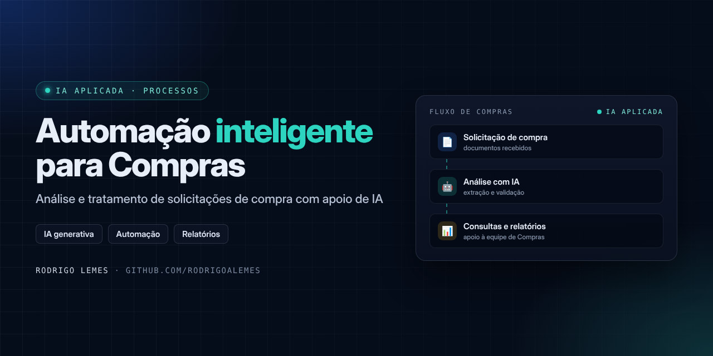
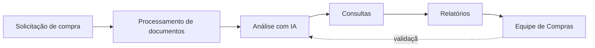

<p align="center">

</p>

<h1 align="center">Automação Inteligente para Compras</h1>
<p align="center"><i>Análise e tratamento de solicitações de compra com apoio de Inteligência Artificial</i></p>

<p align="center">


</p>

## Sumário

- [Sobre](#sobre)
- [Problema e solução](#problema-e-solução)
- [Funcionalidades](#funcionalidades)
- [Como funciona](#como-funciona)
- [Tecnologias](#tecnologias)
- [Benefícios](#benefícios)
- [Estrutura do repositório](#estrutura-do-repositório)
- [Autor](#autor)

## Sobre

Solução baseada em **Inteligência Artificial** para apoiar a análise e o tratamento de **solicitações de compra**. Atuação na **primeira fase** do projeto: análise de requisitos, desenvolvimento da solução, automação de processos e validação funcional junto à área de Compras.

> [!NOTE]
> Projeto desenvolvido em ambiente corporativo. O código-fonte e os dados não são publicados por conterem informações internas; este repositório documenta o problema, a solução e o funcionamento.

## Problema e solução

| | |
| --- | --- |
| **Problema** | O tratamento das solicitações de compra envolvia leitura de documentos, consultas e montagem de relatórios de forma manual, com alto esforço operacional. |
| **Solução** | Automatizar o processamento de documentos, as consultas e a geração de relatórios com apoio de IA, deixando a equipe focada na análise. |

## Funcionalidades

- Processamento automatizado de documentos das solicitações
- Consultas automatizadas sobre as informações extraídas
- Geração de relatórios para a equipe de Compras
- Validação funcional feita junto à área usuária

## Como funciona



Detalhes: [Como funciona](docs/como-funciona.md) · [Escopo da fase 1](docs/fase-1.md)

## Tecnologias

| Tecnologia | Uso no projeto |
| --- | --- |
| IA generativa | Apoio à leitura e análise das solicitações |
| Automação de processos | Encadeamento das etapas sem intervenção manual |
| Relatórios | Saída consolidada para a equipe de Compras |

## Benefícios

- Menor esforço operacional no tratamento das solicitações
- Mais eficiência no processo de Compras
- Base para as próximas fases do projeto

## Estrutura do repositório

```text
automacao-inteligente-compras/
├── assets/
│   └── capa.png
├── docs/
│   ├── como-funciona.md
│   └── fase-1.md
└── README.md
```

## Autor

**Rodrigo Lemes** · Analista de TI · Microsoft 365, AD/Entra ID, Automação, Power BI e IA aplicada

[](https://www.linkedin.com/in/rodrigoalemes/)
[](https://github.com/rodrigoalemes)
